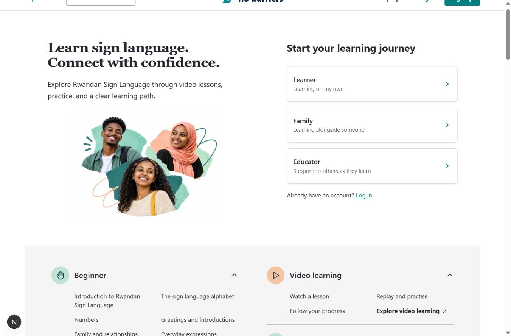

# No Barriers

An e-learning platform for **Rwandan Sign Language**, built so learners, families and educators can take part in more inclusive conversations, one lesson at a time.

This repository is the v2 rebuild. The original site lives at [assapkibasha/no-barriers](https://github.com/assapkibasha/no-barriers).



## Status

Early preview. The landing page and learner workspace work, but there is **no backend yet**: sign-in is simulated and progress is stored in the browser's `localStorage`.

Roadmap, tracked as issues:

1. [#1](https://github.com/assapkibasha/no-barriers-v2/issues/1) Project foundations
2. [#2](https://github.com/assapkibasha/no-barriers-v2/issues/2) Real routes and frontend restructure
3. [#3](https://github.com/assapkibasha/no-barriers-v2/issues/3) MongoDB Atlas data layer
4. [#4](https://github.com/assapkibasha/no-barriers-v2/issues/4) Authentication
5. [#5](https://github.com/assapkibasha/no-barriers-v2/issues/5) Server-validated learning API

## Getting started

Requires Node.js 22 or newer.

```bash
npm install
npm run dev
```

Open [http://localhost:3000](http://localhost:3000).

## Routes

| Route | Page |
| --- | --- |
| `/` | Landing page |
| `/login`, `/register` | Sign-in and registration preview (`/register?role=Educator` preselects a role) |
| `/learn` | Learner dashboard |
| `/learn/[lessonSlug]` | Lesson, e.g. `/learn/numbers` (locked until the previous lesson is complete) |
| `/profile`, `/certificates`, `/studio` | Workspace screens |

## Scripts

| Command | What it does |
| --- | --- |
| `npm run dev` | Start the development server |
| `npm run build` | Production build |
| `npm start` | Serve the production build |
| `npm run lint` | ESLint |
| `npm run typecheck` | TypeScript check without emitting |
| `npm test` | Unit tests for the learning rules (Node test runner) |

## Project structure

```
src/
  app/
    page.tsx                 Landing page route
    (auth)/                  /login and /register
    (workspace)/             Learner workspace routes, sharing one layout and progress state
  components/
    landing/                 Landing page
    auth/                    Sign-in / registration form
    workspace/               Workspace shell, screens and ProgressProvider
  lib/
    curriculum.ts            Levels and lessons (single source for landing and workspace)
    audiences.ts             Learner / Family / Educator roles
    learning/rules.ts        Lesson completion rules: animations, answers, hearts, XP
tests/                       Tests for the learning rules
docs/                        Design references, theme and planning notes
```

`src/lib/learning/rules.ts` holds the core learning logic and is written to run on the server. Answers are processed only once per submission, content-version changes are detected, and XP is never accepted from the browser.

## Tech stack

- [Next.js 16](https://nextjs.org) (App Router) and React 19
- TypeScript
- CSS Modules, with shared brand tokens in `src/app/globals.css`
- [Tabler Icons](https://tabler.io/icons)
- Planned: MongoDB Atlas (Mongoose) and Better Auth, deployed on Vercel

## Contributing

Work happens on branches and is merged through pull requests. CI runs lint, typecheck, tests and a production build on every PR.
